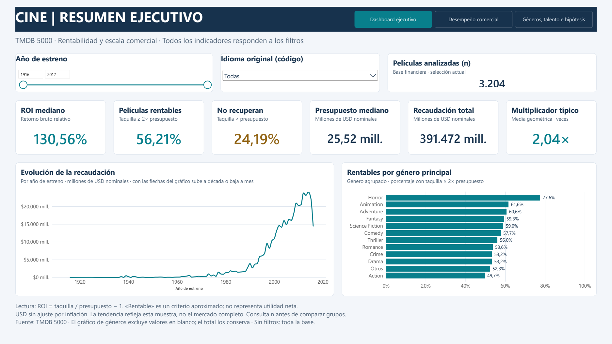
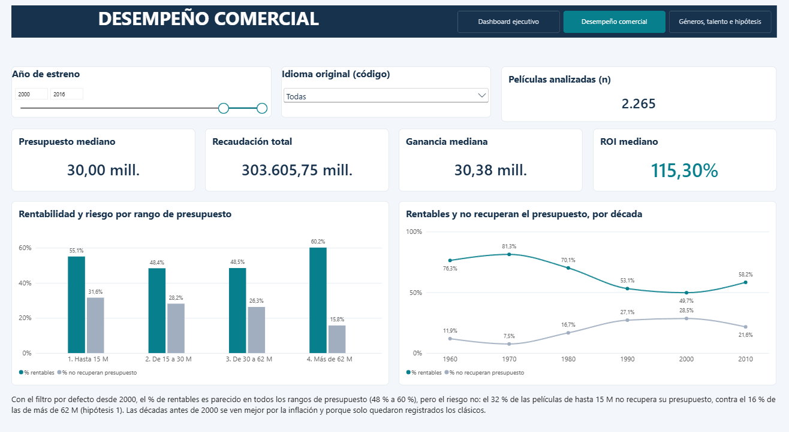
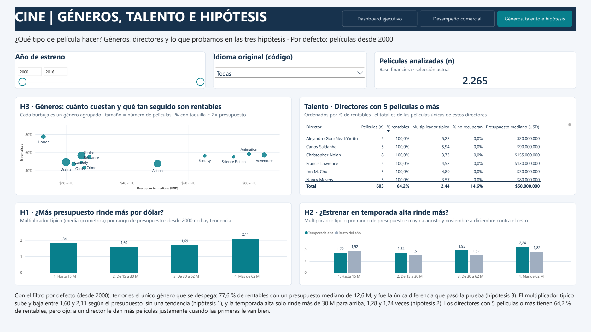
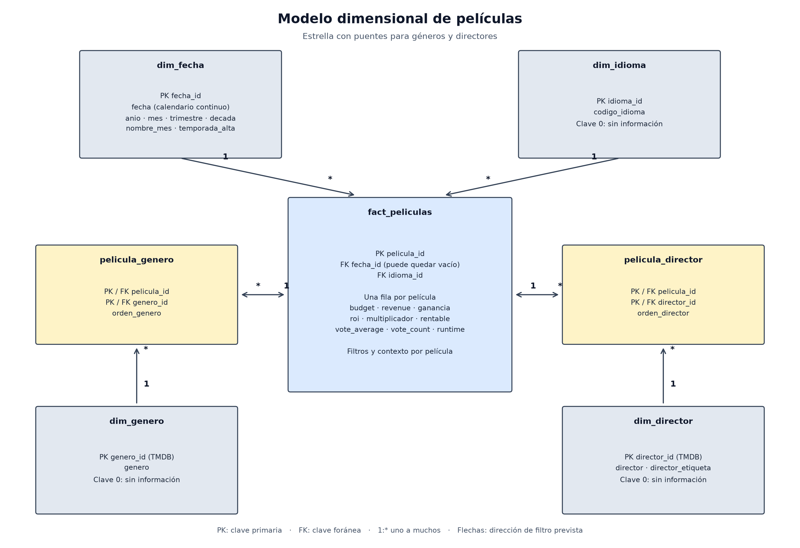

# Análisis de Datos — Evento Evaluativo 3: Business Intelligence con películas

**Instituto Tecnológico Metropolitano (ITM)**
Departamento de Sistemas · Ingeniería de Sistemas
Curso: Análisis de Datos · Docente: Daniel Alexis Nieto Mora · Semestre 2026-2
Equipo 6 — Películas

## Integrantes

- Julián
- Santiago
- Oscar Alexis
- Jacobo

Nos repartimos el trabajo por commits, rotando entre los cuatro, así que en el historial del repo se puede ver qué hizo cada uno.

## Objetivo

Desarrollar un proyecto integral de Business Intelligence sobre la industria del cine: transformar los datos de TMDB en información útil para la toma de decisiones mediante hipótesis validadas estadísticamente, indicadores clave (KPIs) y un dashboard interactivo en Power BI.

Para que el proyecto respondiera algo concreto, nos imaginamos una productora independiente que tiene poca plata y tiene que escoger en qué películas invertirla. Esa productora se pregunta tres cosas: si meterle más presupuesto a una película hace que rinda más por cada dólar, si estrenar en temporada alta mejora el retorno y si el género influye en que la película sea rentable. Todo el proyecto gira alrededor de esas tres preguntas.

Y no es una pregunta menor, porque el negocio es muy riesgoso: en los datos, una de cada cuatro películas no recupera en taquilla lo que costó, y el 10 % más taquillero se lleva casi la mitad de toda la recaudación.

## Dataset

**TMDB 5000 Movie Dataset** — fuente secundaria publicada en Kaggle:
https://www.kaggle.com/datasets/tmdb/tmdb-movie-metadata

| Archivo | Contenido |
|---|---|
| `data/raw/tmdb_5000_movies.csv.zip` | 4.803 películas y 20 columnas: presupuesto, recaudación, géneros, fecha de estreno, duración, popularidad, calificación, votos, idioma, productoras y países |
| `data/raw/tmdb_5000_credits.csv.zip` | Reparto y equipo técnico de cada película |

Los archivos se dejan comprimidos tal como se descargan de Kaggle; pandas los lee directamente con `pd.read_csv`.

Ojo con algo que encontramos apenas empezamos a explorar: los ceros de presupuesto (21,6 %) y de recaudación (29,7 %) no son películas gratis, son datos que nadie reportó. Por eso todo lo que tiene que ver con plata lo calculamos sobre lo que llamamos la base financiera, que son 3.204 películas estrenadas, con presupuesto y recaudación reportados y sin montos menores a 10.000 dólares. Y casi siempre miramos solo las 2.265 de esa base que se estrenaron desde 2000 (la última con cifras es de 2016), porque las películas viejas cambian los resultados, como se ve en la hipótesis 1.

## Metodología

Seguimos las seis fases del enunciado:

1. Comprensión del problema. En el notebook 01 describimos los dos archivos, clasificamos las variables y planteamos el problema de la productora con sus tres preguntas.
2. Formulación de hipótesis. En la primera parte del notebook 03 sacamos una hipótesis por pregunta, con su H0 y su H1, y escogimos la prueba de cada una: correlación de Spearman para el presupuesto, t de Student en la versión de Welch sobre el logaritmo del multiplicador para la temporada, y chi-cuadrado para el género. Trabajamos con α = 0,05 y pruebas bilaterales.
3. Preparación y modelado. En el notebook 02 hicimos el diagnóstico de calidad y la limpieza (los montos que faltaban no los inventamos), sacamos el director de los créditos y creamos variables como el multiplicador, el ROI, si la película es rentable (recaudó al menos el doble de lo que costó) y si salió en temporada alta. Ahí mismo armamos el modelo en estrella para Power BI, que quedó en `data/model/`.
4. KPIs. En el notebook 04 definimos seis indicadores y los calculamos por género, década, idioma y temporada. Esos valores quedaron en `data/processed/kpis_referencia.csv` para comparar con lo que da Power BI.
5. Dashboard. En Power BI montamos el modelo con sus relaciones, las medidas DAX de los KPIs y tres páginas con filtros de año e idioma, botones para pasar de una página a otra y un tooltip con los KPIs.
6. Análisis y storytelling. Corrimos las pruebas en la segunda parte del notebook 03, y en el notebook 05 juntamos todo: qué responde cada pregunta, qué le recomendamos a la productora y hasta dónde llegan los resultados.

Algunas cosas que usamos no están en las guías del curso: la t de Welch, la V de Cramér, la media geométrica, la corrección de Bonferroni, la regla de 2x para decir que una película es rentable y una simulación por remuestreo. En los notebooks lo aclaramos cada vez que aparecen.

## Estructura del repositorio

```text
analisis-datos-evento-3/
├── README.md
├── requirements.txt
├── .gitignore
├── data/
│   ├── raw/          # datos originales de Kaggle
│   ├── processed/    # datos limpios, variables y tabla de referencia de los KPIs
│   └── model/        # tablas de hechos, dimensiones y puentes para Power BI
├── notebooks/
│   ├── 01_comprension_problema.ipynb
│   ├── 02_preparacion_modelado.ipynb
│   ├── 03_hipotesis_pruebas.ipynb
│   ├── 04_kpis.ipynb
│   └── 05_analisis_storytelling.ipynb
├── dashboard/        # archivo de Power BI y su versión en PDF
├── images/           # capturas del dashboard y diagrama del modelo
└── docs/             # diapositivas y material del video
```

## Instalación

```bash
git clone https://github.com/JulianHZ711/analisis-datos-evento-3.git
cd analisis-datos-evento-3
python -m venv venv
# Windows
venv\Scripts\activate
# Linux / macOS
source venv/bin/activate
pip install -r requirements.txt
```

Para el dashboard se necesita Power BI Desktop (gratuito, solo para Windows).

## Ejecución

Los notebooks se corren en orden (01 → 05) desde la carpeta `notebooks/`, porque las rutas a los datos son relativas a esa carpeta. Cada uno lee lo que el anterior dejó guardado en `data/`, entonces también se pueden abrir sueltos.

El dashboard está en `dashboard/dashboard_peliculas.pbix` y ya trae los datos cargados. Si le dan Actualizar, Power BI vuelve a leer las tablas de `data/model/` directamente de este repositorio en GitHub, así que necesita internet (la primera vez pide credenciales de contenido web y se escoge Anónimo). Para el que no tenga Power BI dejamos el mismo dashboard en PDF, en `dashboard/dashboard_peliculas.pdf`.

## Resultados

Este es el resumen de las tres pruebas, con las películas desde 2000:

| Pregunta | Prueba | Resultado |
|---|---|---|
| ¿Más presupuesto rinde más por dólar? | Spearman | ρ = −0,0001, valor p = 0,996. No se rechaza H0 |
| ¿Estrenar en temporada alta rinde más? | t de Welch | Multiplicador típico 1,16 veces mayor (IC 95 %: 1,04 a 1,30), valor p = 0,008. Se rechaza H0 |
| ¿El género influye en que sea rentable? | Chi-cuadrado | χ² = 48,76 con 11 gl, valor p = 1,0 × 10⁻⁶, V de Cramér = 0,147. Se rechaza H0 |

Lo primero que nos llamó la atención fue lo del presupuesto. Con toda la base sale una correlación negativa (ρ = −0,137, valor p = 7,5 × 10⁻¹⁵), o sea que las películas baratas parecían rendir más, pero cuando quitamos las de antes de 2000 la correlación desaparece. Eran los clásicos viejos, con presupuestos en dólares de otra época, los que la estaban armando. Lo que sí cambia con el presupuesto es el riesgo: el 31,6 % de las películas de hasta 15 M no recupera lo que costó, contra el 15,8 % de las de más de 62 M.

La temporada alta sí se asocia con un retorno mayor, más o menos un 16 %, pero la ventaja está en las películas de más de 30 M. En las de hasta 15 M no encontramos evidencia de que ayude (0,89 veces, valor p = 0,470).

En los géneros, el único que se despega es terror: 77,6 % de rentables con un presupuesto mediano de 12,6 M, y en las películas de hasta 15 M llega al 82,7 %. Si se saca terror, la prueba entre los demás géneros da un valor p de 0,069, así que entre ellos no hay evidencia de diferencias. Acción es el caso contrario: se lleva el 24,1 % de la taquilla desde 2000, pero su ROI mediano (87,9 %) queda por debajo del total (115,3 %). Recaudar más no quiere decir rendir más.

Los KPIs cuentan lo mismo. Desde 2000 el ROI mediano es de 115,3 %, el 53,2 % de las películas son rentables, el 25,6 % no recupera el presupuesto, el presupuesto mediano es de 30 M, la recaudación total suma 303.606 M y el multiplicador típico es de 1,81x. Todos se pueden mover con los filtros del dashboard.

Así quedó el dashboard. La primera página es el resumen ejecutivo con los seis KPIs, y arranca con toda la base:



La segunda mira el presupuesto, la recaudación y el riesgo por rango de presupuesto y por década:



Y la tercera muestra los géneros, los directores con 5 películas o más y una gráfica por hipótesis. Estas dos últimas arrancan con las películas desde 2000:



Detrás está este modelo en estrella, con `fact_peliculas` en el centro y dos tablas puente para que una película con varios géneros o varios directores no se cuente dos veces:



## Conclusiones

Para una productora con poca plata, lo que más pesa no es cuánto puede llegar a ganar una película sino el riesgo de perder lo que invirtió. Más presupuesto no hace que una película rinda más por dólar, pero una sola película pequeña falla casi una de cada tres veces. Por eso le recomendamos lo siguiente (el detalle está en el notebook 05):

1. Repartir la plata en varias películas pequeñas en vez de apostarla toda a una sola. En una simulación, cuatro películas de 5 a 10 M no recuperaron lo invertido en el 7,5 % de los casos, contra el 26,6 % de una sola de 25 a 35 M.
2. Darle prioridad al terror cuando el presupuesto es bajo.
3. No pagar de más por estrenar en temporada alta si la película es pequeña. Si algún día hace una de más de 30 M, ahí sí vale la pena pelear la fecha.
4. Medir el éxito por retorno y riesgo, y no por cuánto recaudó.

Eso sí, los resultados tienen sus límites. Son datos observados y no un experimento, así que no prueban que el presupuesto, la fecha o el género causen el resultado; por ejemplo, los estudios guardan la temporada alta para sus películas más fuertes. La base solo tiene las películas que reportaron cifras, que son sobre todo comerciales, y las pequeñas que fracasaron aparecen menos, entonces el riesgo real de las baratas puede ser todavía mayor. Además, el 95,3 % de las películas desde 2000 son en inglés, así que esto no se puede pasar tal cual al mercado colombiano. Y comparamos taquilla contra presupuesto en dólares de cada año, sin publicidad ni lo que se quedan las salas, o sea que no estamos hablando de ganancia neta.

Si algo nos deja el proyecto es que no hay que quedarse con el primer resultado. Lo del presupuesto parecía clarísimo al principio y terminó siendo un efecto de mezclar épocas. Revisar cada cosa por periodo, por tamaño de película y por qué tan grande es el efecto, y no solo mirar el valor p, fue lo que nos cambió las recomendaciones.
