# Evaluación 4: predicción de cancelaciones hoteleras y segmentación de reservas

**Instituto Tecnológico Metropolitano (ITM)**
Departamento de Sistemas · Ingeniería de Sistemas
Curso: Análisis de Datos · Docente: Daniel Alexis Nieto Mora · Semestre 2026-2
Equipo 6

## Integrantes

- Julián Zapata Gutierrez
- Santiago Villada Arboleda
- Oscar Alexis Pineda Henao
- Jacobo Osorio Zapata

Igual que en el Evento 3, nos repartimos el trabajo por commits, rotando entre los cuatro. Cada uno hizo una parte de la exploración o el preprocesamiento, una del componente supervisado, una del no supervisado y una del cierre:

| Integrante | Commits |
|---|---|
| Oscar | Estructura y descripción del problema · Regresión logística · K-Means · Comparación entre los dos enfoques |
| Julián | Calidad de los datos · Máquina de vectores de soporte · Agrupamiento jerárquico y comparación de métodos · Estrategias y conclusiones |
| Santiago | Análisis exploratorio de las cancelaciones · Ajuste de hiperparámetros y evaluación en prueba · Perfiles y estabilidad de los segmentos · Este README |
| Jacobo | Preprocesamiento sin fuga de información · Importancia de variables y estabilidad del modelo · Reducción de dimensionalidad · Enlace al video y revisión final |

## Descripción

Una noche de hotel es un producto que se vence: si la habitación queda vacía hoy, esa noche ya no se puede vender después. Cuando un cliente cancela tarde o no llega, el hotel pierde esa plata, y para defenderse sobrevende o pide depósitos, que también tienen su costo. Las dos cosas funcionan mejor si el hotel sabe, cuando entra una reserva, qué tan probable es que se cancele y qué tipo de reserva es.

Con las reservas de dos hoteles de Portugal trabajamos dos componentes:

- **Supervisado:** entrenamos modelos que anticipan si una reserva se va a cancelar (`is_canceled`), usando solo lo que se sabe en el momento de reservar.
- **No supervisado:** agrupamos las reservas en segmentos según la anticipación, la duración, los huéspedes, el tipo de cliente y el canal, sin usar la cancelación, y después miramos cuánto cancela cada segmento.

Al final comparamos los dos enfoques y proponemos estrategias para que el hotel reduzca las cancelaciones o lo que le cuestan.

Las preguntas que nos propusimos responder:

1. ¿Qué características de una reserva permiten anticipar que se va a cancelar?
2. ¿Qué tan bien se puede predecir una cancelación solo con lo que se sabe al momento de reservar?
3. ¿Qué perfiles de reservas existen?
4. ¿Cómo se relacionan esos perfiles con las cancelaciones y qué estrategias sugieren?

Las respuestas cortas están en [Resultados](#resultados), y las largas, con su evidencia, en el notebook 05.

## Datos

**Hotel Booking Demand**, publicado en Kaggle:
https://www.kaggle.com/datasets/jessemostipak/hotel-booking-demand

Los datos originales son del artículo de Antonio, N., de Almeida, A. y Nunes, L. (2019). Hotel booking demand datasets. *Data in Brief*, 22, 41-49. https://doi.org/10.1016/j.dib.2018.11.083

Es una fuente secundaria: los autores sacaron los datos del sistema de reservas de los hoteles y los anonimizaron, así que los hoteles no tienen nombre y la agencia, la empresa y los tipos de habitación vienen como códigos.

| Archivo | Contenido |
|---|---|
| `data/raw/hotel_bookings.csv.zip` | 119.390 reservas y 32 columnas de un hotel de playa (Algarve) y uno de ciudad (Lisboa), con llegadas entre julio de 2015 y agosto de 2017 |
| `data/processed/entrenamiento.csv.gz` | 63.351 reservas ya limpias para entrenar, con las variables que entran a los modelos, la etiqueta, el grupo de perfil y dos fechas de control. Lo genera el notebook 02 |
| `data/processed/prueba.csv.gz` | 15.839 reservas con las mismas columnas, para la evaluación final. Lo genera el notebook 02 |

El archivo crudo se deja comprimido tal como se descarga de Kaggle; pandas lo lee directamente con `pd.read_csv`. Los dos archivos procesados también quedan en el repositorio, para que los notebooks 03 a 05 se puedan correr sin pasar por el 02.

## Estructura

```text
evaluacion 4/
├── README.md
├── requirements.txt
├── data/
│   ├── raw/
│   │   └── hotel_bookings.csv.zip        # tal como viene de Kaggle
│   └── processed/
│       ├── entrenamiento.csv.gz          # 80 % de la base limpia
│       └── prueba.csv.gz                 # 20 %, se usa una sola vez
├── src/
│   └── preprocesamiento.py               # columnas que entran, preprocesador y particionador
├── notebooks/
│   ├── 01_problema_y_exploracion.ipynb   # problema, calidad de los datos y EDA de las cancelaciones
│   ├── 02_preprocesamiento.ipynb         # limpieza, variables, duplicados y partición sin fuga
│   ├── 03_supervisado.ipynb              # regresión logística, SVM, ajuste, prueba, importancia y estabilidad
│   ├── 04_no_supervisado.ipynb           # K-Means, Ward, perfiles, estabilidad, PCA y t-SNE
│   └── 05_comparacion_y_conclusiones.ipynb  # las 8 preguntas, estrategias y conclusiones
└── images/                               # figuras de este README, sacadas de los notebooks
```

Qué hay en cada notebook:

| Notebook | Secciones |
|---|---|
| 01 · Problema y exploración | 1. El problema y los datos · 2. Calidad de los datos · 3. Análisis exploratorio de las cancelaciones |
| 02 · Preprocesamiento | Reglas de calidad, variables que se conocen al reservar, duplicados sobre lo que ve el modelo, partición por perfil y pipeline |
| 03 · Supervisado | 1. Qué predecimos · 2. Regresión logística · 3. SVM · 4. Ajuste de hiperparámetros y evaluación en prueba · 5. Qué variables usa la SVM · 6. Estabilidad del modelo |
| 04 · No supervisado | 1. Qué buscamos · 2. K-Means · 3. Agrupamiento jerárquico y comparación · 4. Perfiles y estabilidad de los segmentos · 5. Reducción de dimensionalidad |
| 05 · Comparación y conclusiones | 1. Comparación entre los dos enfoques y las 8 preguntas del enunciado · 2. Estrategias para reducir las cancelaciones · 3. Conclusiones |

`src/preprocesamiento.py` reúne lo que comparten los notebooks 02 y 03: la semilla (42), las listas de columnas que entran, `crear_preprocesador()`, que estandariza las numéricas y hace one-hot de las categóricas agrupando las raras, y `crear_particionador()`, la validación cruzada estratificada y agrupada por perfil de reserva.

## Ejecución

```bash
git clone https://github.com/JulianHZ711/analisis-datos-evento-3.git
cd "analisis-datos-evento-3/evaluacion 4"
python -m venv venv
# Windows
venv\Scripts\activate
# Linux / macOS
source venv/bin/activate
pip install -r requirements.txt
jupyter notebook
```

Ojo con dos cosas:

- La carpeta se llama `evaluacion 4`, con espacio, así que en la terminal siempre va entre comillas.
- Los notebooks se abren desde la carpeta `notebooks/`, porque las rutas a los datos y a `src/` son relativas a esa carpeta (`../data/...`).

Se corren en orden, del 01 al 05. El 02 vuelve a generar los archivos de `data/processed/`, y como todo usa la semilla 42, salen iguales a los que ya están en el repositorio.

Cuánto se demoran: casi todos tardan pocos minutos, pero el **03 tarda alrededor de dos horas**, porque la búsqueda de hiperparámetros de la SVM (sección 4.2) pasa de una hora por sí sola. Lo medimos en un computador con 12 núcleos. El 05 no vuelve a entrenar la SVM: toma sus cifras de los notebooks 03 y 04, y solo reentrena la logística y el K-Means, que tardan segundos.

Lo corrimos con Python 3.12 y 3.13, pandas 3.0 y scikit-learn 1.9.

## Decisiones técnicas

### Qué entra al modelo

La regla que acordamos es que una variable solo entra si se conoce en el momento de hacer la reserva. Con esa regla, y con la evidencia de la sección 3.8 del notebook 01 y la sección 3 del notebook 02, quedaron por fuera:

| Variables | Por qué salen |
|---|---|
| `reservation_status` y `reservation_status_date` | Son la respuesta escrita de otra forma: con una resta entre la fecha del estado y la llegada se acierta el 99,95 % de las cancelaciones |
| `assigned_room_type`, `booking_changes` y `days_in_waiting_list` | Se llenan después de reservar, hasta la llegada o la cancelación |
| `country` | Sin *Non Refund*, en *Offline TA/TO* Portugal cancela 39,7 % y el resto de países 0,5 %. Todo apunta a que el país se corrige en el check-in |
| `required_car_parking_spaces` | Ninguna de las 7.313 reservas con parqueadero se canceló, cuando se esperarían unas 2.194 |
| `total_of_special_requests`, `deposit_type` y `adr` | Pueden reflejar pedidos, pagos o tarifas que se registran después de la reserva |

Entran 10 variables numéricas (anticipación, noches, huéspedes, menores, historial del cliente y si tiene empresa) y 8 categóricas (hotel, mes de llegada, plan de comidas, segmento, canal, agencia, habitación reservada y tipo de cliente).

### Duplicados y partición

El CSV trae 31.994 filas idénticas a otra y no tiene número de reserva, así que no se sabe cuáles son copias y cuáles habitaciones reales de un grupo. Con todas las filas se cancela el 37,0 %, y quitando las idénticas, el 27,5 %. El notebook 02 quitó las filas imposibles (tarifas fuera de rango, reservas sin huéspedes o sin noches) y después los duplicados sobre las columnas que ve el modelo, la fecha de llegada y la etiqueta, no sobre las 32 originales. La base final quedó con 79.190 reservas y 29,2 % de cancelación.

Las reservas con exactamente las mismas entradas quedan en un mismo `grupo_perfil`, y tanto la partición 80/20 como la validación cruzada de 5 particiones respetan esos grupos (`StratifiedGroupKFold`). Así dos reservas iguales nunca quedan una en ajuste y la otra en validación o prueba.

### Sin fuga de información

Todo lo que aprende de los datos (la estandarización, qué categorías son raras, el one-hot) va dentro de un `Pipeline` de scikit-learn, así que en cada partición se ajusta solo con las filas de ajuste. Los hiperparámetros, el umbral y el modelo final se escogieron con validación cruzada, y la prueba se usó una sola vez, al final (notebook 03, sección 4.5).

### Algoritmos

| Componente | Algoritmos | Por qué |
|---|---|---|
| Supervisado | Regresión logística | Modelo base: interpretable con sus coeficientes y rápido |
| Supervisado | Máquina de vectores de soporte con kernel RBF | Su frontera curva sigue relaciones no lineales, como la de la anticipación, que la logística no capta. En el plan inicial iba un bosque aleatorio; lo cambiamos por una SVM porque es uno de los modelos supervisados de la guía de las semanas 12-13 |
| No supervisado | K-Means | Trabaja con las 63.351 reservas, ubica una reserva nueva en su segmento y su centro es la reserva típica |
| No supervisado | Jerárquico aglomerativo con enlace de Ward | No depende del punto de partida y el dendrograma muestra cuántos grupos hay. Con todas las reservas la matriz de distancias ocuparía 16,1 GB, así que se aplicó sobre una muestra de 10.000 |
| Reducción | PCA y t-SNE | Para ver los segmentos en dos dimensiones |

Otras decisiones que vale la pena tener presentes:

- Los dos modelos supervisados usan `class_weight="balanced"`: sin pesos, la logística solo detectaba el 26,3 % de las cancelaciones.
- Las métricas son las del enunciado (F1, Recall, Precision y ROC-AUC), con PR-AUC y matriz de confusión de apoyo. El accuracy solo no sirve: un modelo que nunca predice cancelación sacaría más del 70 %.
- El umbral de cada modelo se escogió sobre su `decision_function`, porque la SVM no da probabilidades, buscando el mayor F1 en validación cruzada.
- En K-Means las variables de conteo pasan por un logaritmo antes de estandarizarse, porque tienen colas largas. Escogimos *k* = 4 porque ninguna medida daba un ganador claro y el cuarto grupo separa un perfil útil para el hotel, los viajes con menores.

## Resultados

### 1. Lo que encontramos en la exploración

Los duplicados cambian las conclusiones, y no solo el promedio. Por eso en el notebook 01 cada tasa se calculó de dos formas, con todas las filas y sin duplicados.

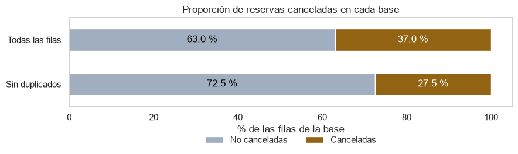

El desbalance es moderado en las dos bases. Con todas las filas cancela el 37,0 % y sin duplicados el 27,5 %, y la diferencia sale casi toda de los bloqueos *Non Refund*, que en un 92,9 % están repetidos.

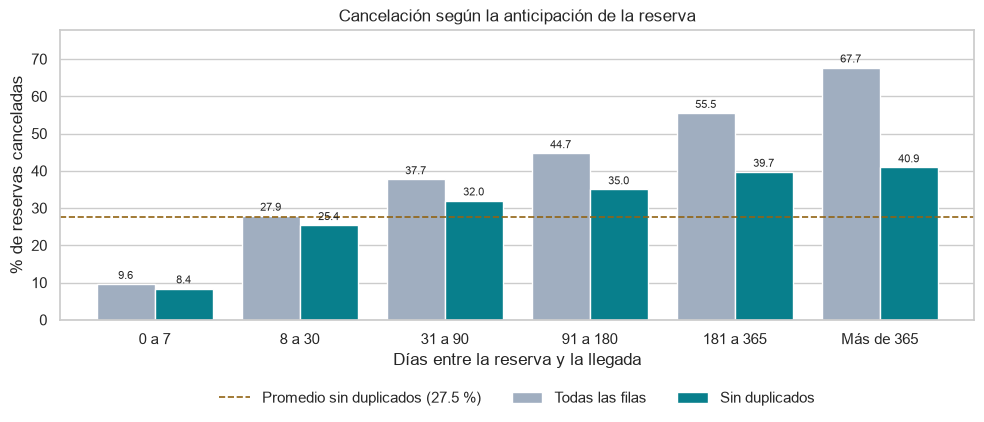

La anticipación es el hallazgo más firme: en las dos bases, entre más días entre la reserva y la llegada, más cancelación. Las reservas de la última semana casi no se cancelan (8,4 % sin duplicados).

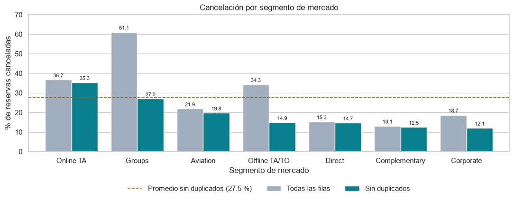

Con todas las filas parecía que el problema eran los grupos (*Groups*, 61,1 %). Sin duplicados baja a 27,0 %, y el segmento que más cancela pasa a ser el de agencias en línea (*Online TA*, 35,3 %), que además tiene el 75,9 % de las cancelaciones.

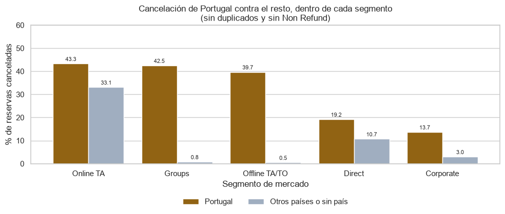

Esta es la evidencia para sacar el país del modelo. En los segmentos donde la reserva la mete una agencia (*Offline TA/TO* y *Groups*), los clientes de cualquier país distinto de Portugal casi nunca cancelan. Eso cuadra con que el país quede como Portugal mientras el cliente no llegue y se corrija en la recepción.

### 2. Componente supervisado

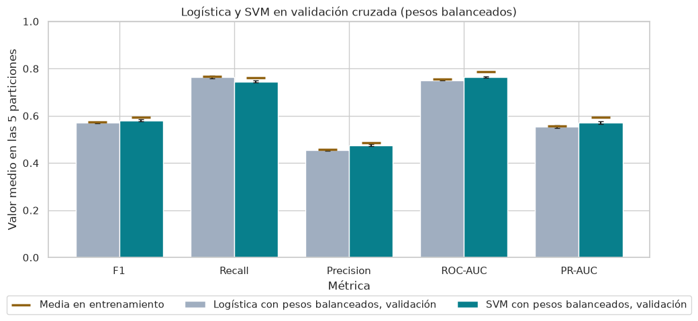

Con la configuración por defecto, la SVM le ganó a la logística en cuatro de las cinco métricas, por poco pero de forma consistente. Las rayas ocres muestran la media en entrenamiento: hay muy poco sobreajuste en los dos modelos.

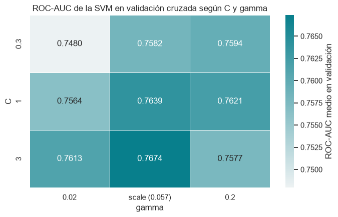

En la búsqueda de hiperparámetros quedó `C=3` con `gamma="scale"`. Con `gamma=0.2` el modelo se aprende el entrenamiento y empeora en validación. En la logística, `C` casi no cambió nada y quedó en 1.

| Modelo | Evaluación | F1 | Recall | Precision | ROC-AUC | PR-AUC |
|---|---|---|---|---|---|---|
| Referencia: marcar todas como canceladas | Validación cruzada | 0,452 | 1,000 | 0,292 | 0,500 | 0,292 |
| Logística (`C=1`, corte 0,086) | Validación cruzada | 0,573 | 0,733 | 0,470 | 0,751 | 0,553 |
| SVM (`C=3`, `gamma="scale"`, corte −0,009) | Validación cruzada | 0,589 | 0,750 | 0,485 | 0,767 | 0,575 |
| Logística | Prueba | 0,575 | 0,736 | 0,471 | 0,754 | 0,559 |
| **SVM, modelo escogido** | **Prueba** | **0,590** | **0,750** | **0,486** | **0,771** | **0,579** |
| Logística entrenada con 2015-2016 (corte 0) | Llegadas de 2017 | 0,548 | 0,758 | 0,430 | 0,727 | 0,482 |
| SVM entrenada con 2015-2016 (corte 0) | Llegadas de 2017 | 0,555 | 0,730 | 0,447 | 0,729 | 0,483 |

Las cifras de prueba son casi iguales a las de validación cruzada, así que la estimación es confiable para reservas como las del histórico. Con otra semilla en la validación, la SVM se mantuvo en un ROC-AUC de 0,769. En cambio, entrenando con 2015-2016 y probando con 2017 bajó a 0,729. El notebook 03 aclara que esa caída no se puede atribuir solo al paso del tiempo, pero es una alerta.

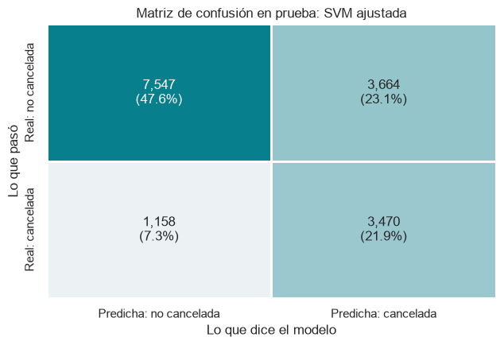

En prueba, la SVM detecta 3.470 de las 4.628 cancelaciones (tres de cada cuatro), pero también marca 3.664 de las 11.211 reservas que sí llegaron. De las que marca, se cancela el 48,6 %, contra el 29,2 % de todas las reservas.

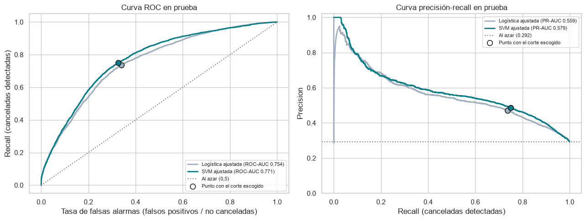

La SVM queda por encima de la logística en casi todo el recorrido de las dos curvas. El punto de cada curva es el corte escogido.

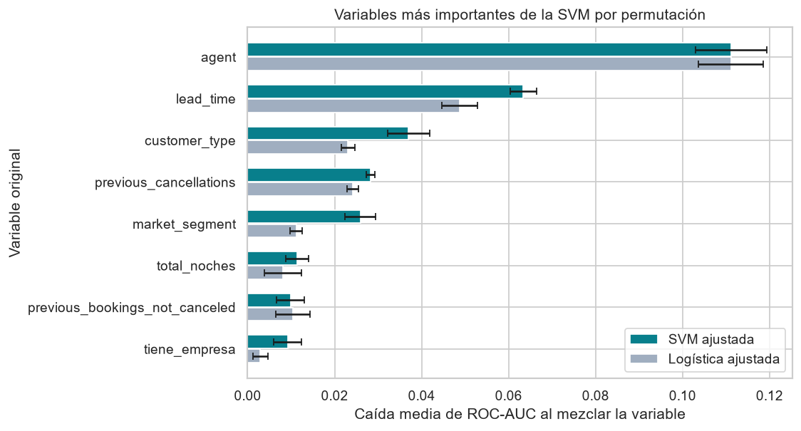

La agencia y la anticipación son las variables que más usa la SVM: mezclar el código de agencia baja el ROC-AUC en 0,111 y mezclar la anticipación, en 0,063. Les siguen el tipo de cliente, las cancelaciones previas y el segmento de mercado.

Sobre el costo de los errores: escoger el corte por F1 equivale, más o menos, a suponer que una cancelación que no vemos venir le cuesta al hotel unas tres veces lo que cuesta una falsa alarma. Eso es razonable si el modelo se usa para algo barato, como llamar a confirmar, pero no para sobrevender (notebook 03, sección 4.6).

### 3. Componente no supervisado

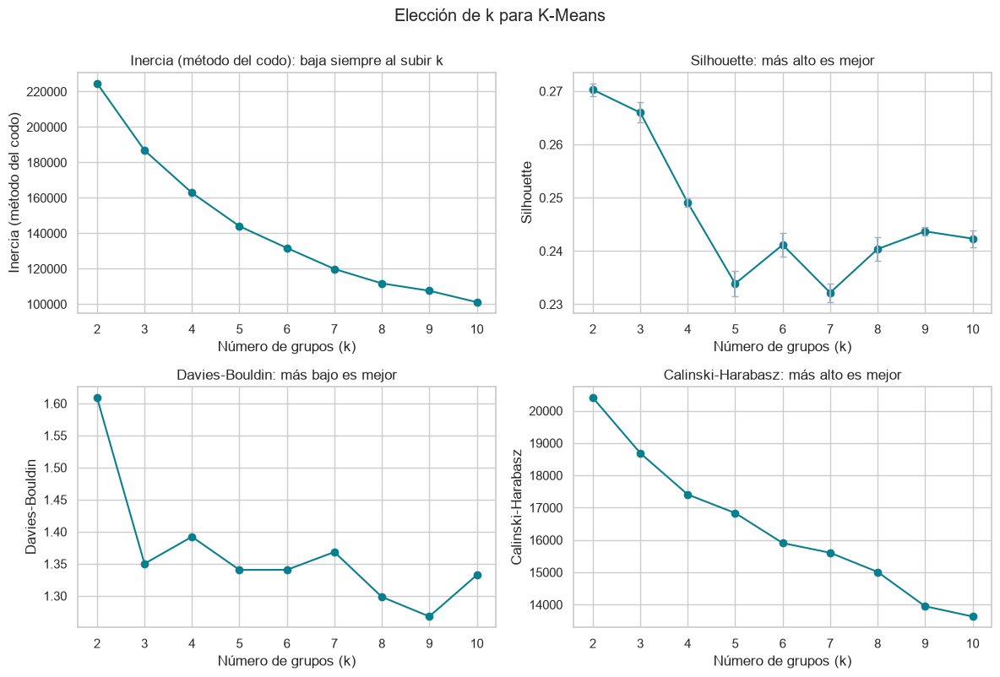

No hay un codo claro y el Silhouette es bajo para cualquier *k* (entre 0,232 y 0,270): las reservas se parecen más a un continuo que a grupos bien separados. Escogimos *k* = 4.

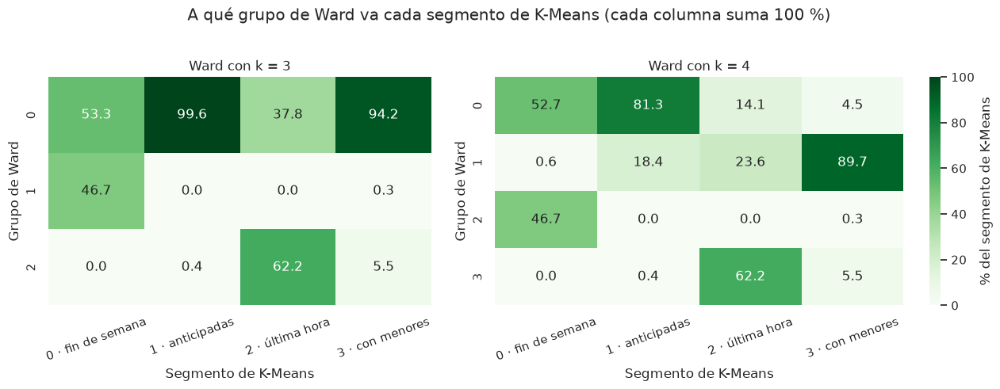

Ward se quedó con *k* = 3 y tiene mejor Silhouette (0,280 contra 0,247 en la misma muestra), pero deja el 76,8 % de las reservas en un solo grupo. Los dos métodos coinciden poco (ARI de 0,281), aunque los dos encuentran los mismos dos núcleos: estancias cortas entre semana con muy poca anticipación y estancias cortas de fin de semana. Seguimos con K-Means porque usa todas las reservas, ubica las nuevas y reparte mejor.

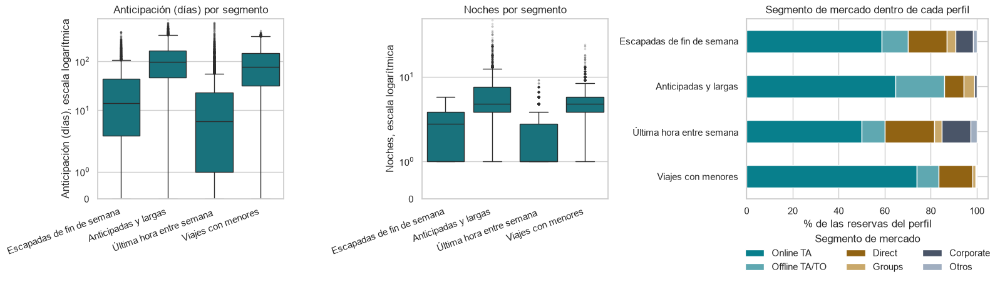

| Segmento | Reservas | Cómo es | Cancelación (entrenamiento / prueba) |
|---|---|---|---|
| Escapadas de fin de semana | 13,4 % | 2 noches, casi todas de fin de semana, 14 días de anticipación | 21,6 % / 22,1 % |
| Anticipadas y largas | 45,5 % | 4 noches, 97 días de anticipación, casi siempre por agencia | 34,6 % / 35,3 % |
| Última hora entre semana | 25,5 % | 1 noche entre semana, 6 días de anticipación, más reservas directas, con empresa y de clientes repetidos | 18,6 % / 18,9 % |
| Viajes con menores | 15,5 % | 3,4 huéspedes, 62,3 % con niños o bebés, 77 días de anticipación, 41,9 % llega en julio o agosto | 37,3 % / 34,5 % |

Los segmentos son estables: salen casi iguales con otras muestras del 80 % (ARI promedio de 0,991) y con las reservas de prueba, que el agrupamiento no vio (ARI de 0,961). Con otras semillas, nueve de diez repiten la misma partición; la que no, cae en una solución peor, con más inercia. El segmento más frágil es el de viajes con menores.

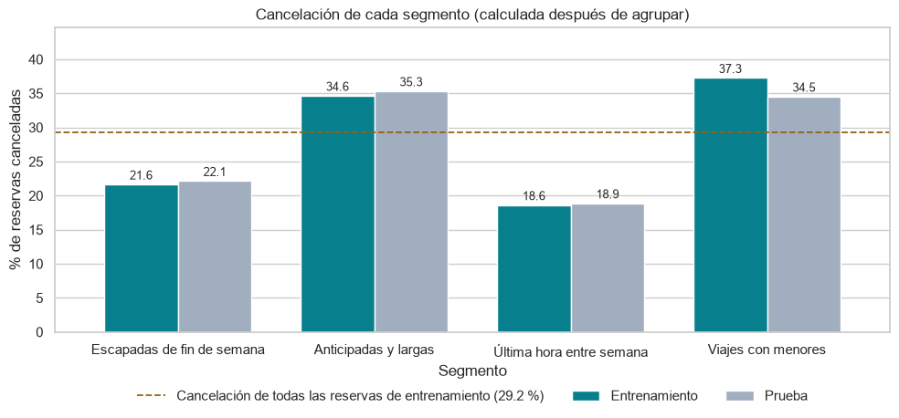

La cancelación no entró al agrupamiento y aun así los segmentos se separan en dos parejas: los que se reservan con tiempo cancelan más que el promedio y los de poca anticipación, menos. La relación es real pero débil (V de Cramér de 0,170). Por volumen, las anticipadas y largas juntan el 54,0 % de las cancelaciones.

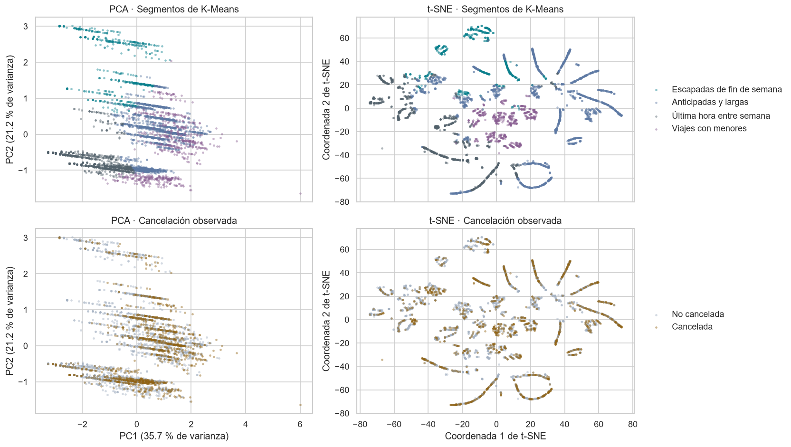

PCA conserva en dos ejes el 56,9 % de la varianza: el primero resume la anticipación, las noches y los huéspedes, y el segundo la proporción de fin de semana. Se pierde casi todo lo del tipo de cliente y el canal. t-SNE conserva mejor qué reservas son vecinas (0,997 contra 0,914 de PCA), pero el tamaño de sus islas y la distancia entre ellas no se pueden leer como reales. En ninguno de los dos planos las canceladas se separan de las no canceladas: es el mismo traslape que limitó al modelo supervisado.

### 4. Los dos enfoques juntos

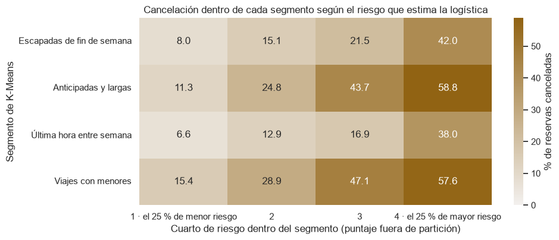

El segmento no reemplaza al modelo supervisado. Dentro de las anticipadas y largas, el cuarto de reservas con menor riesgo según la logística cancela el 11,3 % y el de mayor riesgo el 58,8 %. Esa diferencia es mucho más grande que la que hay entre segmentos. El segmento dice dónde se concentra el riesgo, y el puntaje dice a qué reservas atender primero dentro de cada uno (notebook 05, sección 1.3).

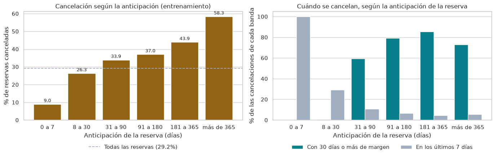

Las reservas hechas con más de un mes de anticipación son el 60,0 % y dejan el 76,3 % de las cancelaciones. Pero la mayoría avisa con tiempo: en las de 91 a 180 días, el 79,2 % se cancela con un mes o más de margen. O sea que el hotel todavía puede volver a vender esa habitación si reacciona rápido.

### 5. Estrategias

| Estrategia | A qué reservas apunta | Evidencia principal | Alcance |
|---|---|---|---|
| 1. Reconfirmar con tiempo | Más de un mes de anticipación, empezando por el cuarto de mayor riesgo | 76,3 % de las cancelaciones; la mayoría cancela con un mes o más de margen | Grande |
| 2. Revisar las condiciones con las agencias 9 y 240 | Las dos agencias en línea más grandes | 49,8 % de las reservas y 69,2 % de las cancelaciones | Grande |
| 3. Fidelizar y promover el canal directo | Clientes repetidos y reservas directas | Cancelan 8,4 % y 15,8 %, contra 30,1 % y 32,8 % | Medio, a largo plazo |
| 4. Pedir garantía a quien ya canceló antes | Clientes con cancelaciones previas | Cancelan 66,5 %, pero son solo el 2,0 % de las reservas | Pequeño |
| 5. Sobreventa por segmento y por mes | Los cuatro segmentos | Tasas estables entre entrenamiento y prueba, pero hasta 16,5 puntos de cambio de un mes a otro | Medio, con riesgo |
| 6. Probar los depósitos antes de imponerlos | Anticipadas de alto riesgo | Los datos no dicen qué efecto tiene un depósito; hay que medirlo | Por definir |

Recomendamos empezar por la 1 y la 2, que son las que más cancelaciones tocan, cada una con un grupo de control para medir si de verdad funciona. Ninguna estrategia está probada: los datos muestran asociaciones, no el efecto de una política.

### 6. Respuestas a las preguntas

1. **¿Qué permite anticipar una cancelación?** Sobre todo la agencia y la anticipación. Después vienen el historial del cliente (las cancelaciones previas suben el riesgo y ser cliente repetido lo baja), el hotel (el City Hotel cancela más) y el canal (el directo cancela menos que el de agencias).
2. **¿Qué tan bien se predice con lo que se sabe al reservar?** Moderadamente. La SVM detecta tres de cada cuatro cancelaciones, pero de cada dos reservas que marca, una sí llega (F1 de 0,590 y ROC-AUC de 0,771 en prueba). Sirve para priorizar acciones baratas, no para decidir sobre una reserva sola.
3. **¿Qué perfiles existen?** Cuatro: escapadas de fin de semana, anticipadas y largas, última hora entre semana y viajes con menores. Son estables, pero la estructura es débil (Silhouette de 0,249): son una forma útil de ordenar las reservas, no tipos naturales.
4. **¿Cómo se relacionan con las cancelaciones?** Los perfiles que se reservan con tiempo cancelan más (34,6 % y 37,3 %) y los de poca anticipación, menos (21,6 % y 18,6 %). Lo principal para el hotel es concentrarse en las reservas anticipadas, que cancelan más pero casi siempre con tiempo de revender, y en las dos agencias que más cancelan.

Nuestra recomendación es usar los dos enfoques juntos: el modelo supervisado para ordenar cada reserva por riesgo cuando entra, y los segmentos para repartir la atención y fijar políticas por perfil. La logística es una alternativa razonable a la SVM si el hotel necesita explicar sus decisiones o reentrenar seguido, porque queda apenas por debajo (F1 de 0,575 contra 0,590 en prueba).

### 7. Limitaciones

- Son dos hoteles de Portugal, de 2015 a 2017 y antes de la pandemia. Para otro hotel habría que repetir el análisis con sus propios datos.
- El modelo pierde fuerza con el tiempo (ROC-AUC de 0,729 en 2017), así que hay que reentrenarlo y vigilarlo.
- No sabemos en qué momento se llena cada campo. Sacar las variables dudosas evitó la fuga, pero también le quitó información al modelo.
- Sin número de reserva no se sabe cuáles duplicados son copias. Según cómo se traten, la cancelación es de 37,0 % o de 29,2 %.
- Las clases se traslapan mucho: hay 1.713 perfiles con exactamente las mismas entradas en los que unas reservas se cancelaron y otras no. Con estas variables, ningún modelo va a acertar mucho más.
- Faltan variables que probablemente pesan, como las condiciones de cancelación de cada agencia o el motivo del viaje.
- Los costos de los errores los supusimos. Con los costos reales del hotel, el corte del modelo puede cambiar.
- Todo son asociaciones en datos históricos, no causas. Las estrategias son hipótesis que hay que probar.
